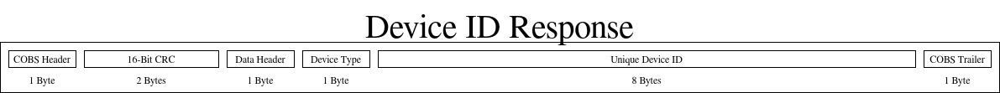
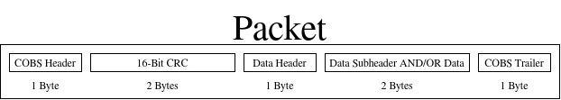
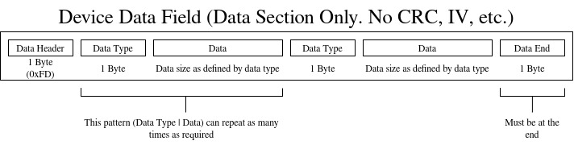

# TCP Communication Protocol Specification

> [!NOTE]
> This documentation details the technical specifications of the protocol used for all TCP communication. **It is not required** to be read or understood for general use of the associated Python library. For usage instructions, please refer to the [Python Library Guide](PYTHON_LIB_GUIDE.md).

## Protocol Scope and Usage

This protocol governs all TCP communication between supported MeT IoT devices, and external clients (e.g., this standalone library, Home Assistant integration).

## Connection Initialization Sequence

### Initialization Sequence

MeT device network discovery and initialization follows this pattern:

1. **Discovery:** The device broadcasts a Zeroconf (mDNS) packet for initial discovery.
2. **Connection:** The client library connects to the device's TCP socket.
3. **Request:** The client library sends a **Device Identification Request** command.
4. **Response:** The device responds with a **Device Identifier Response** packet.
5. **Operation:** Regular data exchange begins.

### Device Identifier Packets

The initial *Device Identification Request* packet follows the general structure outlined in [Packet Structure Breakdown](#packet-structure-breakdown), utilizing the Data Header field to contain the [identification request header](#standard-controller-to-node-commands) with an empty data section.

The structure of the *Device Identification Response* packet still follows the [outlined packet structure](#packet-structure-breakdown), utilizing the data section for a 1-byte device type, followed by an 8-byte unique device identifier.

## General Packet Format

All data over the TCP connection adheres to a common structure.

### Packet Structure Breakdown

| Field | Bytes | Description |
| - | - | - |
| COBS Header | 1 | Marks the start of the packet and contains information for COBS decoding. |
| CRC | 2 | 16-bit Cyclic Redundancy Check for error detection across the entire data payload. |
| Data Header | 1 | Identifies the overall purpose or type of the packet (e.g., data transfer, identification). |
| Data Payload | 0-n | The main data content. Its exact structure depends on the Data Header. |
| COBS Trailer | 1 | Marks the end of the packet, always the value `0x00`. |

### Purpose of Protocol Components

* **Consistent Overhead Byte Stuffing (COBS):** Ensures reliable packet delimitation by guaranteeing the packet trailer byte (`0x00`) never appears in the body of the packet. The header contains essential information for the receiver on how to decode the data.
* **Cyclic Redundancy Check (CRC):** A 16-bit code used for robust error detection. If the received CRC does not match the CRC recalculated from the Data Header and Payload, the packet is discarded as corrupted. The CRC algorithm is based on: G.D. Nguyen, “Fast CRCs,” IEEE Transactions on Computers, vol. 58, no. 10, pp. 1321-1331, Oct. 2009.

## Data Header Commands and Flow

> [!NOTE]
> All relevant **Bytes** columns in tables **do not include protocol overhead** and only include the length of the header + data. The protocol overhead specifically refers to COBS trailer, COBS deliminator, and 16-Bit CRC which account for a total of **4 bytes not included in those values**.

The Data Header (1 byte) is the first piece of information after the CRC and determines the primary function of the packet.

### Standard Controller-to-Node Commands

These are requests or notifications sent from the client library to the MeT IoT device.

| Purpose | Data Header | Data Payload | Bytes |
| - | - | - | - |
| Malformed Packet Notification | `0xFF` | (None) | 1 |
| Device Identification Request | `0xFE` | (None) | 1 |

### Standard Node-to-Controller Commands

These are responses or unsolicited notifications sent from the MeT IoT device to the client library.

| Purpose | Data Header | Data Payload | Bytes |
| - | - | - | - |
| Malformed Packet Notification | `0xFF` | (None) | 1 |
| Device Identifier | `0xFE` | [1 byte Device ID + 8 byte Unique Device ID](#device-identifier-response-packet). | 10 |
| Data Transfer | `0xFD` | [Variable-length structure.](#data-field-format) | n |

### Device Identification Codes

This 1-byte code is carried in the **Device Identifier** packet (`0xFE`).

| Code (1 Byte) | Device Type |
| - | - |
| `0xFF` | Fish Tank |
| `0xFE` | Filter Guardian |
| ... | *(Future device's)* |

## Data Payload Structure (Header 0xFD)

When the **Data Header** is `0xFD` (Data Transfer), the **Data Payload** is structured as a series of repeating **Sub-Header** and **Data** fields.

### Data Field Format

The Data Payload consists of one or more data points, each preceded by its own Sub-Header. This pattern repeats until the payload ends: `Sub-Header`, `Data`, `Sub-Header`, `Data`, ...

| Field | Purpose |
| - | - |
| Data Sub-Header | Identifies the specific data point (e.g., "Current Temp"). |
| Data | The actual data value, interpreted based on the Sub-Header. |

### Supported Data Types

> [!IMPORTANT]
> The following standard C/C++ data types are supported for transmission within the **Data** field:
>
> * `int8_t`
> * `int16_t`
> * `int32_t`
> * `int64_t`
>
> *All unsigned variants of the above data types are allowed*
>
> The following data types *can* be used but research must first be conducted to ensure each device's architecture supports the same byte length.
>
> * `float`
> * `double`

## Device-Specific Protocol: Fish Tank

This section details the custom commands and data formats specific to the Fish Tank device (`Device ID: 0xFF`). The Fish Tank protocol still inherits all commands defined in [Data Header Commands and Flow](#data-header-commands-and-flow).

### Fish Tank: Controller-to-Node Commands

| Purpose | Data Header | Data Payload | Bytes |
| - | - | - | - |
| Sensor Attribute Request | `0xFC` | None | 1 |
| Calibration Values | `0xFB` | *To be decided* | |

### Fish Tank: Node-to-Controller Commands

| Purpose | Data Header | Data Payload | Bytes |
| - | - | - | - |
| Sensor Attribute Response | `0xFC` | *To be decided* | |
| Calibration Finished | `0xFB` | 1-Byte Sensor Address | 2 |

### Fish Tank: Data Sub-Header Types

This section describes how sensor types and individual sensor instances are identified within the `Sensor Attribute Response` packet.

#### Identifier Byte

The Identifier Byte is a single byte split into two 4-bit nibbles:

| Bits | Purpose | Description |
|-|-|-|
| 7-4 (High Nibble) | Sensor Type | Defines the category of sensor (see table below). |
| 3-0 (Low Nibble) | Sensor Index | A unique ID (0-15) assigned to each physical sensor of the same type on this device. |

#### Sensor Types

> [!NOTE]
> Values marked with (decimal value) are transmitted as integers multiplied by 100 (e.g., 25.50 is sent as `2550`) and must be divided by 100 upon interpretation.

| Sensor Type (Nibble) | Data Field | Data Type | 
| - | - | - |
| `0xF` | Temperature *(decimal value)* | `int16_t` |
| `0xE` | Humidity *(decimal value)* | `uint16_t` |
| `0xD` | pH *(decimal value)* | `uint16_t` |
| `0xC` | Oxidation-Reduction Potential | `int16_t` |
| `0xB` | Dissolved Oxygen | `int16_t` |
| `0xA` | Conductivity | `int16_t` |

### Fish Tank: Calibration

#### Calibration Values Command

> [!WARNING]
> This device does not yet support calibration over TCP

#### Calibration Finished Command

> [!WARNING]
> This device does not yet support calibration over TCP

# Device-Specific Protocol: Filter Guardian

This section details the custom commands and data formats specific to the Filter Guardian device (`Device ID: 0xFE`). The Filter Guardian protocol still inherits all commands defined in [Data Header Commands and Flow](#data-header-commands-and-flow).

### Filter Guardian: Controller-to-Node Commands

| Purpose | Data Header | Data Payload | Bytes |
|-|-|-|-|
| ... | ... | ... | ... |

### Filter Guardian: Node-to-Controller Commands

| Purpose | Data Header | Data Payload | Bytes |
|-|-|-|-|
| ... | ... | ... | ... |

### Filter Guardian: Data Sub-Header

| Sub-Header | Data Field | Data Type |
| - | - | - |
| `0xFF` | Flow Rate *(decimal value)* | `uint16_t` |
| `0xFE` | Pressure Port 1 *(decimal value)* | `uint16_t` |
| `0xFD` | Pressure Port 2 *(decimal value)* | `uint16_t` |
| `0xFC` | Flood Sensor *(0xFF if not fitted, bool otherwise)* | `uint8_t` |
